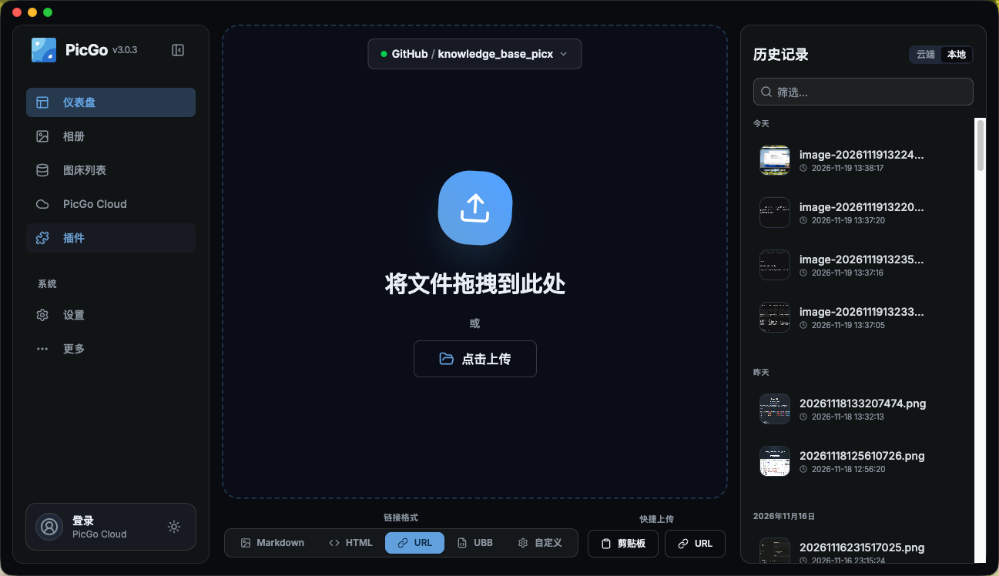
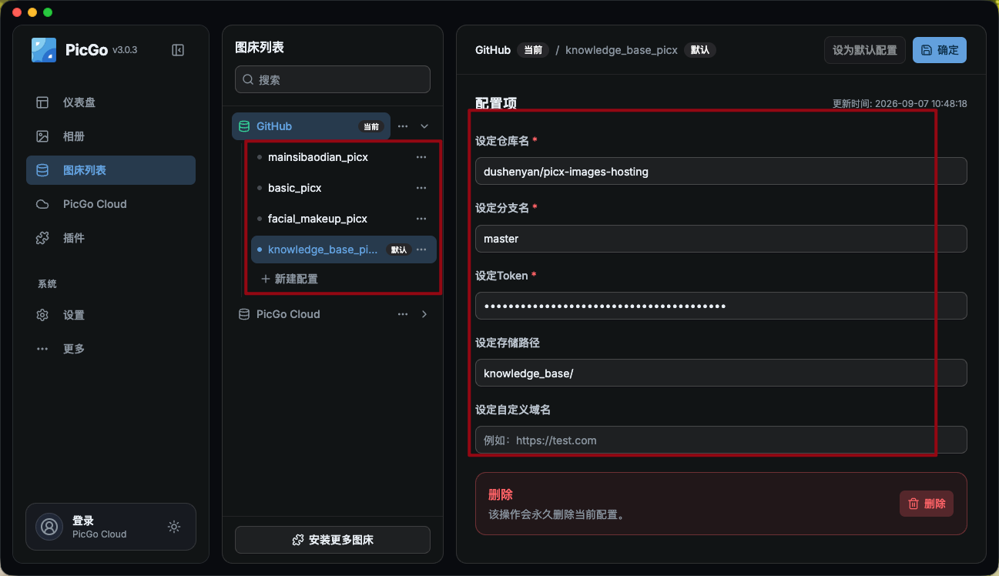
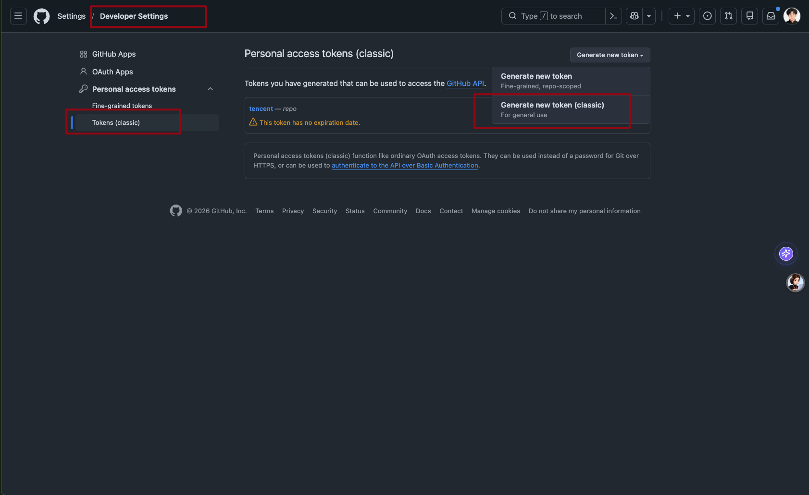

# PicGo 图床使用教程

写 Markdown 文章时，图片需要一个能公开访问的地址。PicGo 就是做这件事的：把本地图片上传到图床，自动生成 Markdown 链接，复制粘贴就能用。它是开源软件，支持 Windows、macOS 和 Linux，官方仓库在 [Molunerfinn/PicGo](https://github.com/Molunerfinn/PicGo/blob/dev/README_zh-CN.md)。

本教程以 GitHub 作为图床，依次介绍界面布局、图床配置、令牌获取、图片压缩、常用插件，以及如何让 AI Agent 帮你自动传图。

## 界面布局



界面分为四个区域。

- **左侧导航栏**：仪表盘（上传主页）、相册、图床列表、PicGo Cloud、插件，下方系统区有「设置」和「更多」。配置图床走「图床列表」，安装插件走「插件」。
- **中间上传区**：顶部显示当前使用的图床（图中为 GitHub / knowledge_base_picx）。把文件拖进来，或点「点击上传」，上传成功后链接自动进入剪贴板。
- **底部链接格式**：选择复制下来的链接形态——Markdown、HTML、URL、UBB、自定义；「快捷上传」可指定上传后复制到剪贴板还是 URL。
- **右侧历史记录**：列出上传过的所有图片，可按「云端 / 本地」切换，支持筛选，每条记录都能直接复制链接。

## 配置 GitHub 图床

进入「图床列表」，选择 GitHub，填写配置项。



各配置项的含义：

| 配置项 | 示例 | 说明 |
|--------|------|------|
| 设定仓库名 | `dushenyuan/picx-images-hosting` | 格式为 `用户名/仓库名`，图片上传到这个仓库 |
| 设定分支名 | `master` | 仓库建在哪个分支就填哪个 |
| 设定 Token | （密文显示） | GitHub 访问令牌，决定 PicGo 能否向仓库推送文件，获取方式见下一节 |
| 设定存储路径 | `knowledge_base/` | 图片在仓库中的存放目录，留空则放在根目录 |
| 设定自定义域名 | `https://test.com` | 仓库绑定了 CDN 或自定义域名时填写，生成的链接用它作前缀 |

一个 GitHub 账户可以建多个仓库当图床，所以图中左侧列了 `mainsibaodian_picx`、`basic_picx`、`knowledge_base_picx` 等多套配置。点右上角「设为默认配置」，决定拖拽上传时实际使用哪一套。

## 获取 GitHub Token

PicGo 上传的本质是往 GitHub 仓库提交文件。GitHub 不认账号密码，只认访问令牌（Personal Access Token），所以要先生成一个。

1. 登录 GitHub，点右上角头像，选择 **Settings**。
2. 左侧栏拉到最底部，点 **Developer settings**。
3. 点 **Personal access tokens**，选择 **Tokens (classic)**。
4. 点 **Generate new token** → **Generate new token (classic)**，按提示输入密码。
5. 填写三项：
   - **Note**：令牌备注，例如 `picgo`，方便日后识别和撤销。
   - **Expiration**：有效期，建议选 90 天。
   - **Select scopes**：勾选 `repo`。图床仓库是公开仓库时，勾 `public_repo` 一项就够；私有仓库必须勾完整的 `repo`。
6. 点 **Generate token**，页面显示的 `ghp_` 开头字符串就是令牌。它只显示一次，立即复制。
7. 回到 PicGo 的 GitHub 配置页，粘贴到「设定 Token」，点右上角「确定」保存。

上面这些操作都在「Personal access tokens (classic)」页面完成，也可以直接访问 `https://github.com/settings/tokens` 跳过来。



这个页面有三处值得注意：

- **左侧栏**：Personal access tokens 下分 Fine-grained tokens 和 Tokens (classic) 两类，PicGo 要用的是 **Tokens (classic)**。
- **右上角下拉**：「Generate new token」提供两个入口——Fine-grained（细粒度、按仓库授权）和 **classic（For general use）**，选后者才会进入上面第 5 步的表单。
- **页面提示**：classic 令牌本质是普通的 OAuth 访问令牌，可以代替密码用于 Git over HTTPS，这正是 PicGo 上传的原理。

图中已有一个名为 `tencent` 的令牌，带黄色警告「This token has no expiration date」。它只是生成时没设有效期，不影响使用，但属于安全隐患：令牌一旦泄露会永久有效。自己的 PicGo 令牌按第 5 步选 90 天有效期即可。

令牌相当于仓库的钥匙，不要提交进任何公开仓库，也不要在分享截图时露出。一旦泄露，回到同一个页面点 Delete 撤销，再重新生成。

## 用 compress-pro 压缩图片

图床的访问速度取决于图片体积，而 PicGo 本身不压缩图片。可以安装 `compress-pro` 插件（作者 rumosky，版本 v1.0.1），上传前自动压缩。

安装方法：进入「插件」页，搜索 `compress-pro`，安装并启用，然后在 Config 标签页配置。


### 阈值(KB)：触发压缩的体积下限

只有图片体积**大于**阈值时，插件才会调用压缩；小于阈值的直接上传原图，省下压缩时间和 API 额度。

按使用场景取值：

- **100**（日常通用）：适合写博客、日常截图、文档配图。手机拍的照片（2-5 MB）和截图都会被压缩，小图标（小于 100 KB）直接跳过，兼顾画质和效率。
- **300 或 500**（重度图片党）：经常发高清摄影图、大图展示时调高，避免不必要的小图压缩拖慢上传。
- **0**（强制全压）：对网页加载速度有极致要求时，每一张图都压缩。

### 在线压缩：tinypng

当前配置选择的压缩方式是 `tinypng`，需要填 TinyPNG Key。Key 在 TinyPNG 开发者页面（`https://tinypng.com/developers`）免费注册申请。两点注意：

1. **API 额度**：TinyPNG 免费版每月只有 500 次压缩额度。把阈值设为 100 KB 能过滤掉大量不需要压缩的小图标，省下额度。
2. **多 Key 叠加**：500 次不够用时，可以在 TinyPNG Key 里用逗号隔开填多个 Key。

### 本地压缩：pngquant 与 jpegoptim

配置下方还有 `pngquant 路径` 和 `jpegoptim 路径` 两项。把压缩方式改成本地压缩，就不消耗 TinyPNG 的网络额度，但有两个代价：

- 本地压缩**有损且耗 CPU**，阈值建议设高一点（比如 200-300），避免本来就很小的图被压得色彩失真。
- 需要先用 Homebrew 安装这两个工具：

  ```bash
  brew install pngquant jpegoptim
  ```

  并在插件里填入正确路径（Apple 芯片的 Mac 通常在 `/opt/homebrew/bin/` 下），否则本地压缩会报错。

对绝大多数场景（尤其是 Markdown 写作），阈值保持 100 即可。

## 其他常用插件

PicGo 核心功能很精简，扩展全靠插件，在「插件」页搜索安装即可。除了 compress-pro，再推荐两个：

- **picgo-plugin-s3**：官方出品的 S3 上传插件，支持 Amazon S3 以及 Cloudflare R2、MinIO 等兼容 S3 协议的存储。GitHub 图床在国内访问不稳定时，换到这类服务体验会好很多。
- **picgo-plugin-convert-heic**：上传前把 HEIC 转成 JPEG 等通用格式。iPhone 和 macOS 默认拍的照片就是 HEIC，直接传图床后很多浏览器打不开，这个插件解决的就是这个问题。

更多插件可以在 npm 上搜索关键词 `picgo-plugin`。

## 在 AI Agent 里直接传图

以上都是手动操作。PicGo 官方还提供了一个 Agent 技能 [picgo-upload](https://github.com/PicGo/skills)（当前版本 1.1.0），装到 AI 编程助手（Codex、Claude Code 等）的技能目录后，写文档时说一句「把这张图传到图床」「这张截图转成 Markdown 图片链接」，Agent 就会自动完成上传。

它的执行顺序是：

1. **优先走桌面应用**：如果 PicGo 正在运行，直接调用它的本地服务，用你已经配置好的图床（比如上面配的 GitHub）上传，零安装、零登录。
2. **退回命令行**：桌面应用没开时，用 `picgo upload /绝对路径/文件名 --format json` 上传。
3. **拿回链接**：两条路径返回同样的 JSON 结果（含 `imgUrl`），Agent 把链接拼成 `` 直接插进文档。

两点边界要知道：

- **链接是公开可访问的**：拿到链接的人都能打开文件。文档截图放心传，但合同、身份证这类敏感文件，Agent 会先和你确认再传。
- **剪贴板不会乱动**：只有你明确说「传剪贴板里的图」，Agent 才会上传剪贴板内容，不会自作主张。

前提是 PicGo 已安装且图床已配置好。换句话说，前面几节就是这个技能能跑起来的基础。
